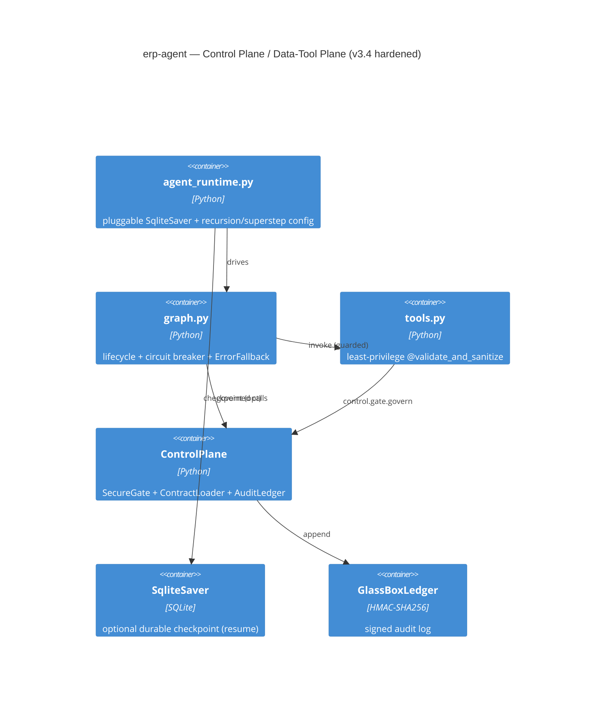

> ⚠️ **GENERATED ARTIFACT — not the source of truth.**
> This document was derived automatically from `intent.txt` / `GOAL.yaml`.
> Edit the human-owned intent instead; regenerate with `python run_agent.py --new-agent <name> --enterprise`.
> Conflicts are resolved with `merge=ours` (see `blueprint/.gitattributes`).
# 02 — Technical Reference Document (AI-derived): `erp-agent`

_Derived from the Intent Contract. In production an LLM fills the prose; the structure below is deterministic._

## 2.1 Allowed Tools
classify_intent, delegate_to_domain_agent

## 2.2 Egress Boundaries
none

## 2.3 Component Map
- Runtime: `agent_runtime.py` (thin Data/Tool Plane) — owns resilience primitives.
- Execution graph: `graph.py` (recursion_limit + superstep circuit breaker).
- Tools: `tools.py` (least-privilege `@validate_and_sanitize` guards).
- Contract: `GOAL.yaml` (compiled from `intent.txt`).
- Control Plane: `dm_agent_governance.runtime.ControlPlane` (fail-closed SecureGate).
- Durable state: optional `SqliteSaver` (`SqliteCheckpointer`) for crash-resume.
- Audit: signed Glass-Box ledger under `audit/`.

## 2.4 Control Plane / Data-Tool Plane (C4 Container)

