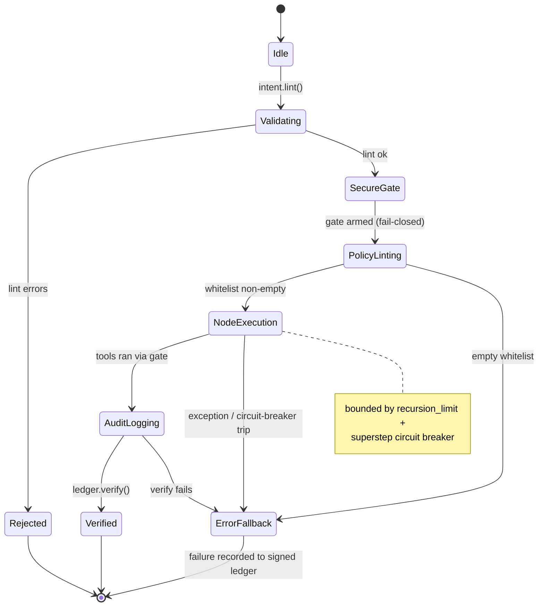

> ⚠️ **GENERATED ARTIFACT — not the source of truth.**
> This document was derived automatically from `intent.txt` / `GOAL.yaml`.
> Edit the human-owned intent instead; regenerate with `python run_agent.py --new-agent <name> --enterprise`.
> Conflicts are resolved with `merge=ours` (see `blueprint/.gitattributes`).
# 03 — Application Flow & State Transitions: `erp-agent`

v3.4 enterprise hardening is reflected in the state machine below: a STRICT
default `recursion_limit` (anti-runaway) and SUPERSTEP CIRCUIT BREAKER bound
execution, and EVERY failure routes to an explicit `ErrorFallback` node — no
silent drops.

