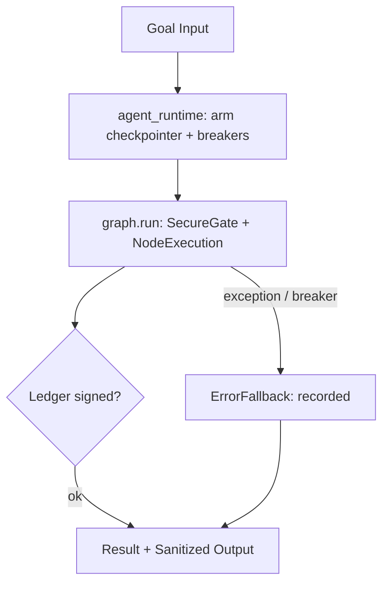

> ⚠️ **GENERATED ARTIFACT — not the source of truth.**
> This document was derived automatically from `intent.txt` / `GOAL.yaml`.
> Edit the human-owned intent instead; regenerate with `python run_agent.py --new-agent <name> --enterprise`.
> Conflicts are resolved with `merge=ours` (see `blueprint/.gitattributes`).
# 04 — UI/UX Design & Component Skeleton: `erp-agent`

## Module Map (v3.4)
- `agent_runtime.py` — thin entry; owns SqliteSaver + breaker config.
- `graph.py` — lifecycle nodes + `Graph` executor (recursion/superstep breakers, `ErrorFallback`).
- `tools.py` — `TOOLS` registry + `@validate_and_sanitize` least-privilege guards.

## Wireframe (Mermaid)


## Executable React/Tailwind skeleton
```tsx
export function AgentConsole({ name }: { name: string }) {
  return (
    <div className="mx-auto max-w-2xl space-y-4 p-6">
      <h1 className="text-xl font-semibold">{name}</h1>
      <button className="rounded bg-slate-900 px-4 py-2 text-white"
              onClick={() => console.log('governed run')}>Run Agent</button>
    </div>
  );
}
```
